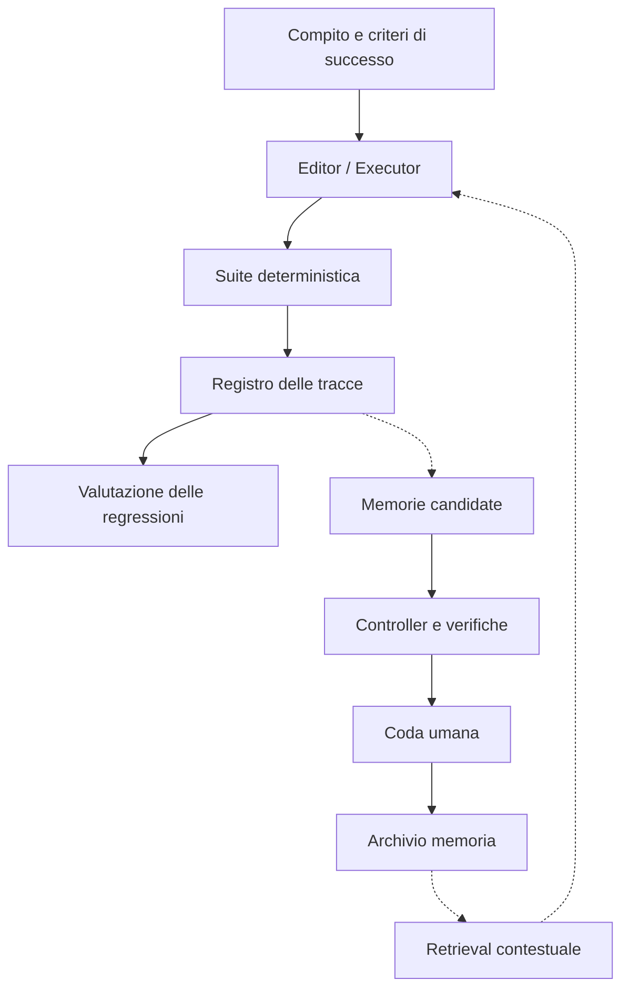

# 02 · Architettura minima e contratti

Le linee tratteggiate indicano funzionalità **ancora non integrate** come pipeline end-to-end.

## Responsabilità e confini

| Modulo | Input | Output | Vincolo |
|---|---|---|---|
| `engine.py` | Record, eventi di verifica trusted, scope e budget | Transizioni e payload memoria selezionata | Non è autenticazione, storage o LLM |
| `acr_memory.schema.json` | Record JSON | Requisiti formali | Schema non dimostra la veridicità dei claim |
| `trace_store.py` | Run, evento, esito deterministico | Tracce SQLite, conteggi delle regressioni | Non è una fonte di test attestata |
| `browser_runner.py` | Fixture locale HTML + browser Chromium | Sei esiti di check per revisione | Test mirati, non audit WCAG completo o prova di efficacia ACR |
| Test suite | Codice e fixture | Esiti software riproducibili | Non misura il beneficio ACR |
| Curator, non ancora sviluppato | Tracce, feedback | Proposte di memoria | Nessun diritto di promozione stato |
| UI approvazione, futura | Candidate/Verified | Decisione umana motivata | Richiede autenticazione e audit |

## Memoria: struttura e fiducia

Campi minimi: `id`, `type`, `claim`, `scope`, `source`, `status`, `evidence`, `created_at`, `expires_at`, `review_after`, `supersedes`, `superseded_by`, `conflict_key`, `history`. Stati: candidate, verified, approved, rejected, superseded, under_review.

- M0: regole normative, originate solo dall'approvazione umana.
- M1: stato operativo temporaneo.
- M2: eventi osservati, non generalizzati.
- M3: procedure corroborate da prove in contesti distinti e da test di generalizzazione.
- La revisione di una memoria deve essere registrata con autore, motivo e data.
- Retrieval: progetto e condizione applicabile, stati ammessi, non scaduta, assenza di conflitto irrisolto, limite memoria di 800 token come **ipotesi di budget**; la selezione va tracciata, comprese le esclusioni.

## Tracce: eventi minimi

Un run identifica `task_id`, braccio, replica, modello e hash della configurazione. Per ogni revisione si registrano almeno riferimenti/hash a prompt e output, memorie recuperate/escluse, esiti per `test_id`/versione e dati di consumo. Il runner Chromium v0.6 ora collega hash delle fixture, versione browser e sei esiti per revisione al trace store. Non collega ancora prompt e output LLM, consumi di token o un registry indipendente delle evidenze. Lo script di audit ricontrolla hash e risultati contro i file locali.

## Sicurezza e privacy

Il testo di una memoria non è affidabile: iniettarlo in un prompt come dato a priorità inferiore non basta per neutralizzare ogni prompt injection. Non conservare API key, identificativi o contenuti personali nel registro di ricerca. Registrare hash e riferimenti a repository protetti, applicare controlli di accesso al futuro database e chiedere una decisione umana per le promozioni a `approved`.

**Avvertenza:** la protezione append-only via trigger SQLite è un controllo contro modifiche accidentali o normali query, **non** un registro antimanomissione crittografico. La v0.5 non include isolamento dei ruoli, registry delle prove indipendente o autenticazione.

## Stack minimo

Python 3.10+, `jsonschema`, `pytest`, SQLite nella libreria standard. Playwright/Chromium è integrato per fixture HTML sintetiche. axe-core e Lighthouse, nonché task reali su copie isolate, rimangono obiettivi successivi. Nessun frontend, server o costosa API AI è necessario per misurare correttamente le prime regressioni registrate.
